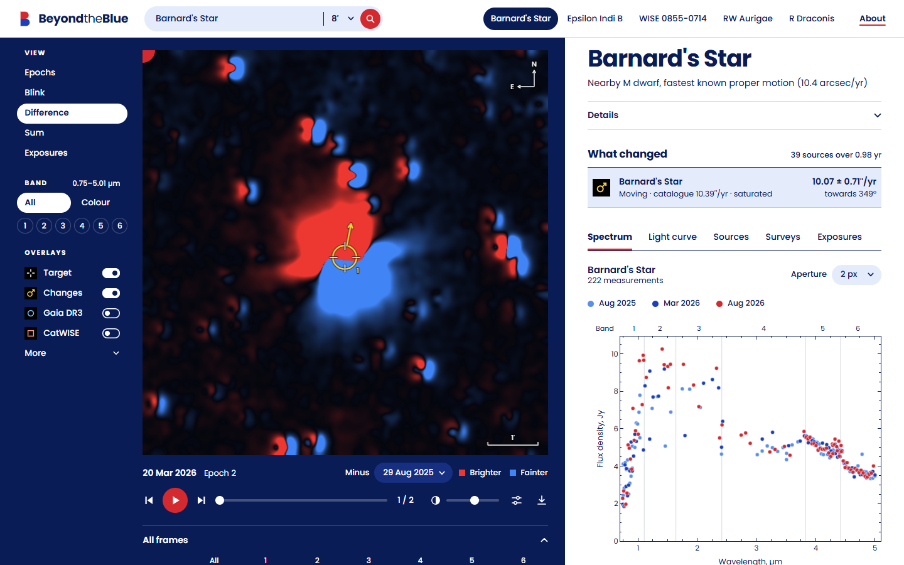
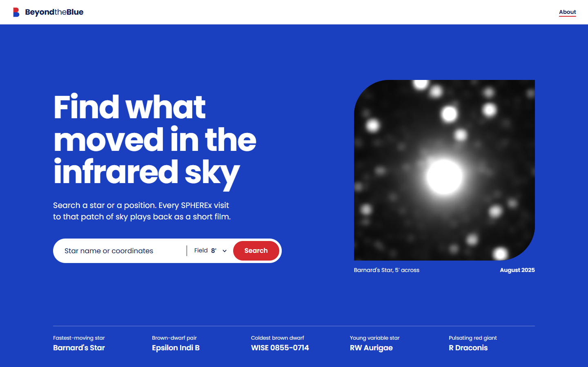
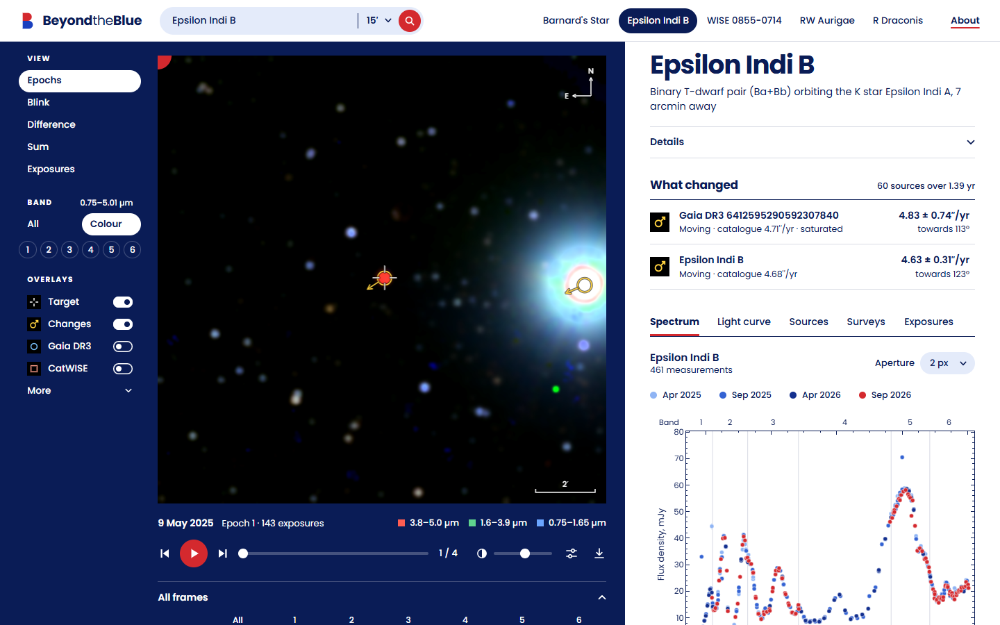
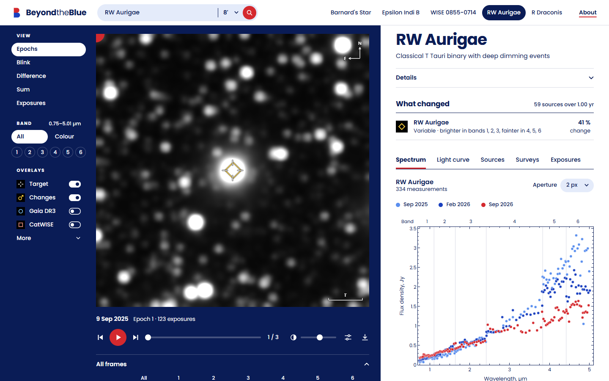
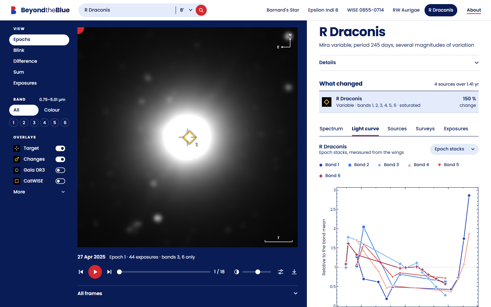
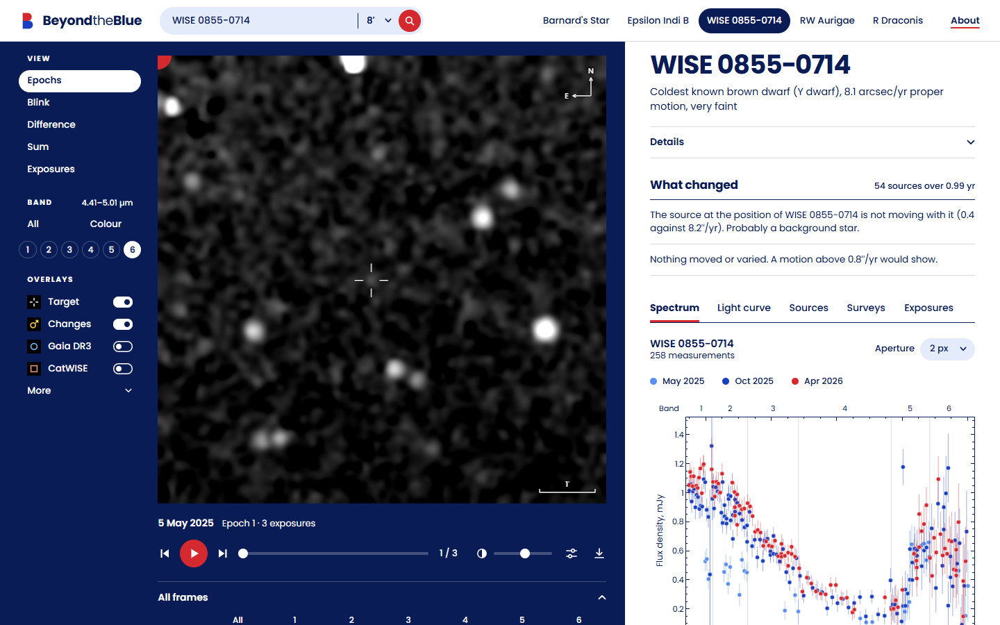

# BeyondtheBlue

Play back every SPHEREx visit to any patch of sky and see what moved or changed.

BeyondtheBlue is a web viewer for NASA's SPHEREx all-sky infrared survey. Type the
name of an object or a position: it finds every SPHEREx spectral image covering
that spot, aligns them, stacks each visit by detector band and plays the visits as
a short film, so anything that moved or changed brightness stands out. It measures
every bright source in every visit, lists the ones that moved or varied, and
extracts a 0.75–5 µm spectrum of anything you click. It runs in the browser, with
nothing to install, and every view has its own address.



*Barnard's Star, 8′ field. The image is the March 2026 epoch minus the August 2025
one: the star's motion leaves a red/blue pair, north to south. The panel on the
right reports the motion the viewer measured (10.1″/yr; the catalogue says 10.4)
and the star's spectrum from every exposure.*



## Features

* **Search by name or coordinates** in any usual form: `Barnard's Star`,
  `133.76 -7.24`, `08h55m10.8s -7d14m42.5s` or
  `Right Ascension 08h55m10.831s, declination -7d14m42.53s`. Five test targets and
  the latest searches are listed under the box.
* **Frame player** with speed control, keyboard shortcuts (Space, ← →) and a grid
  of every epoch in every band.
* **Five ways to compare visits**: every epoch in turn, blink between two,
  difference against a reference epoch, the sum of all epochs, and single
  exposures labelled with their wavelength. The sum can follow a chosen proper
  motion (shift and add), so a faint moving object stays in one place.
* **All six detector bands**, 0.75–5.01 µm. Per epoch, the exposures of each
  detector are averaged with outlier rejection. Show one band, all six together,
  or **Colour**: one image painted from three pairs of bands (0.75–1.65 µm blue,
  1.6–3.9 µm green, 3.8–5.0 µm red), in which cold objects stand out red among
  blue-white stars.
* **What changed**: the sources that moved or varied are found automatically and
  listed with their measured motion or amplitude.
* **Spectra and light curves on the fly**: click any source and its flux is
  measured in every exposure, plotted against wavelength (one colour per epoch)
  and against time.
* **Overlays and context**: Gaia DR3 and CatWISE2020 sources drawn at the date of
  each frame with proper-motion arrows; SPHEREx pixel flags as a colour overlay
  and in the cursor read-out; the same field in unWISE, the Legacy Surveys and
  Aladin Lite.
* **Field of view** from 3′ to 30′.
* **Save and share**: WebM video, PNG frame, every frame as FITS, a link to the
  exact view, and ready `<iframe>` code for a compact player.
* **New data releases appear by themselves**: the list of SPHEREx collections is
  read from IRSA, not written in the code.
* **Guided tour** for first-time visitors; *About → Take the tour* runs it again.

## Results on five test targets

Measured by the viewer itself from SPHEREx data (DR1 + QR3, November 2026). The
“What changed” panel reports them without any user input.

| Target | Epochs, exposures | What the viewer reports | Catalogue |
| --- | --- | --- | --- |
| Barnard's Star | 3 visits, 390 | Moving: 10.1 ± 0.7″/yr towards 349° | 10.39″/yr towards 356° |
| Epsilon Indi B | 4 visits, 572 (15′ field) | Two moving sources: the brown-dwarf pair, 4.6 ± 0.3″/yr towards 123°, and the primary star 7′ away, 4.8 ± 0.7″/yr | 4.68″/yr towards 122° |
| WISE 0855−0714 | 3 visits, 289 | This year the brown dwarf is passing within a pixel of a background star, so the image alone cannot separate them and the viewer says so. The spectrum at its position can: the star's light fades towards 3.5 µm, then the flux climbs steeply from 4 to 5 µm, where a 250 K brown dwarf emits | 8.15″/yr; 0.5 mJy at 4.6 µm |
| RW Aurigae | 3 visits, 358 | Variable in all six bands, with a colour change: brighter at 0.75–1.65 µm, fainter at 2.4–5 µm over the year | T Tauri variable |
| R Draconis | 18 monthly bins, 718 of 2675 | Variable in all six bands by a factor of several, following its 245-day cycle. Saturated, so it is measured from the wings of its image | Mira variable |

| | |
| --- | --- |
|  Epsilon Indi in colour: the brown-dwarf pair (centre, orange) and the primary (right) flagged as moving together |  RW Aurigae: three epochs, three different spectra |
|  R Draconis: the 245-day cycle in all six bands |  WISE 0855: band 6, and the 4–5 µm rise in the spectrum |

Two things learned from these targets are built in. The position usually quoted
for WISE 0855 (08h55m10.8s −7d14m42.5s) is where WISE saw it in 2010; the brown
dwarf has since moved 2.2′ west. Chosen by name, the viewer applies the proper
motion before centring; given those coordinates, it shows that field and says
“WISE 0855−0714 was here in 2010. It is now 2.2′ to the west”, with a button to
follow it. R Draconis sits near the ecliptic pole, where SPHEREx never stops
observing, so its exposures are cut into monthly bins instead of six-monthly visits.

## How it works

1. **Search.** IRSA's Simple Image Access service lists every Level 2 spectral
   image (one per detector per exposure) that touches the field, as in the IRSA
   tutorial notebooks.
2. **Cutouts without downloads.** Each image is a 60–70 MB multi-extension FITS
   file. The server asks IRSA for exactly the bytes it needs with HTTP range
   requests. The image search already reports where each detector pointed (its
   four corners and centre); combined with the detector's known distortion that
   predicts the pixel rows to within 0.1 pixel, so the header and the rows of the
   `IMAGE` extension arrive in **one request per file**. The real header always
   decides what is used; a wrong prediction only costs a second request.
3. **Alignment.** Every cutout is resampled (bilinear, aware of missing pixels)
   onto one north-up grid centred on the target, after subtracting its own sky
   level, which is mostly zodiacal light and differs for every wavelength.
4. **Epochs and bands.** Exposures separated by more than 45 days belong to
   different visits; continuous coverage is cut into 30-day bins. Within an
   epoch the exposures of each detector are averaged after rejecting samples
   more than five robust deviations from the median. “All detectors” is the mean
   of the six band images, so every epoch has the same effective bandpass.
5. **What changed.** Sources are found on the mean of the epochs, in the
   all-detector stack and in a 3.8–5 µm stack where cold objects are brightest.
   Each is centroided in every epoch. The field stars calibrate the residual
   registration (typically 0.01–0.02 pixel) and the photometric repeatability
   (1–3 %). A source is reported as moving when a straight-line fit is at least
   5σ and 0.25 pixel over the baseline, counting the scatter of its own track as
   error. It is reported as variable when it changes in at least two bands and in
   most of the bands where it is detected.
6. **Spectra.** The `WCS-WAVE` table gives the wavelength of every detector
   pixel. Aperture photometry of a position in every exposure (following its
   proper motion when it has one) gives flux against wavelength and against time.

Frames reach the browser as 32-bit floats, so stretch, colour map, blink,
difference, sum and shift-and-add are immediate and need no further requests.

### Cost of a new field

Measured on a slow link (about 300 kB/s, 300 ms round trip to IRSA):

| | Requests | Data | Time |
| --- | --- | --- | --- |
| 6′ field, 325 exposures, nothing cached | 326 | 21 MB | 83 s |
| The same field again | 0 | 0 | under 10 s |

Every cutout, header and search result is cached on disk, and finished frame sets
are cached whole. On a server close to IRSA the first load is limited by request
latency rather than bandwidth and takes a fraction of this.

### When IRSA is slow or out of reach

Everything is read live from IRSA, and IRSA has bad hours. The viewer is built so
that this costs a visitor as little as possible:

* **The five test targets always open, in about three seconds.** Their finished
  frames, target spectra and image searches are saved inside the package
  (`spherex_viewer/snapshots/`, written by `scripts/snapshot.py`). On a server
  that has never read a target, the saved copy is shown at once while the field
  is read from IRSA; the reading shows over the image as it goes, and the live
  frames replace the copy when they are in. If IRSA cannot be reached the saved
  copy stays, and the page says which date it is from.
* **A field seen before never waits for the search.** An old cached search is
  answered immediately and renewed in the background.
* **One search serves every view of a field.** IRSA takes as long to search a
  small circle as a 15′ one, so fields up to 15′ share one search around their
  centre and each view (another field of view, single exposures, a spectrum) is
  cut from it. The same search or file asked for twice at once goes to IRSA once.
* **Nothing incomplete is remembered.** A result with exposures that failed to
  read, or with a release that could not be searched, is shown with a notice and
  is not cached, so the next load tries again.
* **The browser rides out a dropped connection** while it waits for a job, and
  starts the job again if the server was restarted in the meantime.
* **A new field during an outage** ends with one plain sentence and a “Try again”
  button after at most 75 seconds, not with a stack trace.

The page itself needs nothing from other sites to start: fonts, the plotting
library and the start-page images are served by the app.

## Running locally

Requirements: Python 3.11 to 3.13 (some of the scientific packages have no builds
for newer versions yet) and internet access to IRSA.

```bash
python -m venv .venv
.venv/bin/pip install -r requirements.txt
.venv/bin/python -m uvicorn spherex_viewer.main:app --port 8000
```

On Windows the commands are `.venv\Scripts\pip` and `.venv\Scripts\python`. Open
<http://127.0.0.1:8000/>, or <http://127.0.0.1:8000/?target=barnard> to start on a
test target.

The first time a field is opened, the server reads hundreds of small pieces of
files from IRSA: from tens of seconds to a few minutes, depending on the link.
After that the field is cached and opens in seconds.

### Tests

Offline, a few seconds:

```bash
.venv/bin/pip install pytest
.venv/bin/python -m pytest -q
```

### Test targets: warm cache and saved copies

```bash
python scripts/precache.py                              # warm the cache for the five targets
python scripts/precache.py wise0855 --fov 8 --spectrum
python scripts/snapshot.py                              # renew spherex_viewer/snapshots/, then commit them
python scripts/snapshot.py --searches                   # only the saved image searches
```

### Settings (environment variables)

| Variable | Default | Meaning |
| --- | --- | --- |
| `SPHEREX_COLLECTIONS` | empty: ask IRSA | Pin the collections to search, best first |
| `SPHEREX_CACHE_DIR` | `./cache` | Disk cache |
| `SPHEREX_CACHE_MAX_GB` | `4` | The oldest files are removed beyond this |
| `SPHEREX_MAX_WORKERS` | `16` | Parallel requests to IRSA |
| `SPHEREX_MAX_EXPOSURES` | `800` | Most exposures read per request; deep fields are sampled evenly |
| `SPHEREX_MAX_FOV_ARCMIN` | `40` | Largest field a user may ask for |
| `SPHEREX_DEFAULT_FLAGS` | `0` | `1` reads the FLAGS extension by default |
| `SPHEREX_WARMUP` | `0` | `1` computes the five test targets at start-up |

## Deployment

The `Dockerfile` listens on `$PORT` (7860 by default) and caches under
`/data/cache`.

```bash
docker build -t beyondtheblue .
docker run -p 7860:7860 -e SPHEREX_WARMUP=1 beyondtheblue
```

* **Render**: `render.yaml` is a ready blueprint (Docker web service with a disk
  for the cache; on the free plan, see the note at the top of the file).
* Any host that runs a Docker image and sets `$PORT` works the same way.
* Choose a region in the United States: every cutout is a round trip to IRSA in
  California.
* `<meta name="repo">` in `frontend/index.html` holds the repository URL shown as
  “Source code” in the About box.

## Links and embedding

Every view is described by its address, so it can be bookmarked, shared or
embedded. The save menu copies both the link and the `<iframe>` code.

| Parameter | Example | Meaning |
| --- | --- | --- |
| `target` | `?target=barnard` | A test target (`barnard`, `epsindi-b`, `wise0855`, `rwaur`, `rdra`), an object name or coordinates |
| `ra`, `dec` | `?ra=133.758&dec=-7.242` | Position in degrees |
| `fov` | `&fov=8` | Field width in arcminutes |
| `band` | `&band=D6` | `D1` to `D6`, or `RGB` for Colour; all bands when absent |
| `mode` | `&mode=diff` | `blink`, `diff` or `sum`; every epoch in turn when absent |
| `seq` | `&seq=exposure` | Single exposures instead of epochs |
| `fps` | `&fps=4` | Playback speed, 0.5 to 8 frames per second |
| `gaia`, `catwise`, `flags`, `invert` | `&gaia=1` | Overlays, and dark sky on a light background |
| `pmra`, `pmdec`, `track` | `&pmra=-802&pmdec=10362&track=1` | Follow a proper motion, in mas/yr |
| `embed` | `&embed=1` | Compact player for an `<iframe>` |
| `tour` | `?tour=1` | Show the guided tour even after it was seen |

## API

| Endpoint | Purpose |
| --- | --- |
| `GET /api/resolve?q=` | Name, test target or coordinates to a position, proper motion and position now |
| `GET /api/presets` | The five test targets, resolved |
| `GET /api/exposures?ra&dec&fov` | Epochs and exposure counts for a field |
| `POST /api/jobs/frames` `{ra, dec, fov, group, detector, flags}` | Start a frame job. Poll `GET /api/jobs/{id}`, then `GET /api/jobs/{id}/result`; `GET /api/jobs/{id}/fits` returns the frames as FITS |
| `POST /api/live` (same body as a frame job) | While a saved copy is on show: progress of the live reading of that field, then `ready` |
| `POST /api/jobs/spectrum` `{ra, dec, pmra, pmdec, epoch, r_ap, field}` | Photometry of a position in every exposure |
| `GET /api/catalog/{gaia\|catwise}?ra&dec&radius` | Catalogue overlay |
| `GET /api/config` | Collections in use, limits, flag bits |
| `GET /api/health` | Liveness check for the host and uptime monitors |

Frame payloads carry base64 little-endian `float32` pixels (MJy/sr, sky
subtracted), a `uint8` exposure count per pixel, optional `uint32` flags, and a
minimal TAN WCS, so other front ends can use them.

## Project structure

```
spherex_viewer/
  releases.py    which SPHEREx collections IRSA serves, and in what order to prefer them
  sia.py         image search: one Exposure per detector per exposure
  fitsrange.py   HTTP byte ranges, multipart answers, FITS structure, compressed tiles
  predict.py     where a sky position lands on a detector, from the search footprint
  archive.py     plans the requests: headers, pixel rows, flags, wavelength tables
  cutouts.py     cutout WCS, flag names, wavelength lookup
  processing.py  epochs, the common grid, resampling, stacking
  detect.py      which sources moved or varied
  photometry.py  aperture photometry for spectra and light curves
  pipeline.py    the two jobs: frames and spectrum
  resolve.py     test targets, coordinate parsing, name resolution, proper motion
  catalogs.py    Gaia DR3 and CatWISE2020 overlays
  snapshots.py   saved frames and spectra of the test targets, for when IRSA is down
  jobs.py        background jobs with progress
  main.py        the web API and static files
frontend/        index.html, styles.css, app.js, tour.js (no build step), fonts, start-page images
scripts/         precache.py, snapshot.py; make_hero.py renders the start-page images from SPHEREx data
tests/           offline unit tests
```

## Limitations

* Quick-look measurements: fixed apertures, no aperture correction, no PSF
  fitting. For science-grade photometry use IRSA's own SPHEREx tools.
* Proper motions below about 0.5″/yr are not detectable yet; the baseline grows
  by six months with every survey.
* Sources with sharp spectral features can differ from epoch to epoch in a band
  stack because each visit samples the features differently. The spectrum tab
  shows the epochs at matched wavelengths, which settles it.
* The automatic list is conservative and covers sources bright enough to
  centroid. Faint movers still need eyes, which is the point of the tool.
* Reading pixel flags costs about 0.4 MB per exposure in DR1 and QR3 files,
  where they are stored compressed by full detector rows, so it is opt-in.

## Data and credits

* SPHEREx spectral images: NASA/JPL-Caltech, served by the NASA/IPAC Infrared
  Science Archive (IRSA), collections DR1 and QR3. Access methods follow the
  [IRSA SPHEREx tutorial notebooks](https://caltech-ipac.github.io/irsa-tutorials/spherex/).
  Flag definitions: SPHEREx Explanatory Supplement.
* Gaia DR3 (ESA/Gaia/DPAC). CatWISE2020 (IRSA). unWISE image cutouts from the
  Legacy Surveys viewer. Aladin Lite and the Sesame name resolver (CDS, Strasbourg).
* Astropy, NumPy, SciPy, FastAPI, Plotly. Typeface: Poppins (SIL Open Font License).

“This publication makes use of data products from the Spectro-Photometer for the
History of the Universe, Epoch of Reionization and Ices Explorer (SPHEREx), which
is a joint project of the Jet Propulsion Laboratory and the California Institute
of Technology, and is funded by the National Aeronautics and Space Administration.”

## License

MIT, see [LICENSE](LICENSE).
